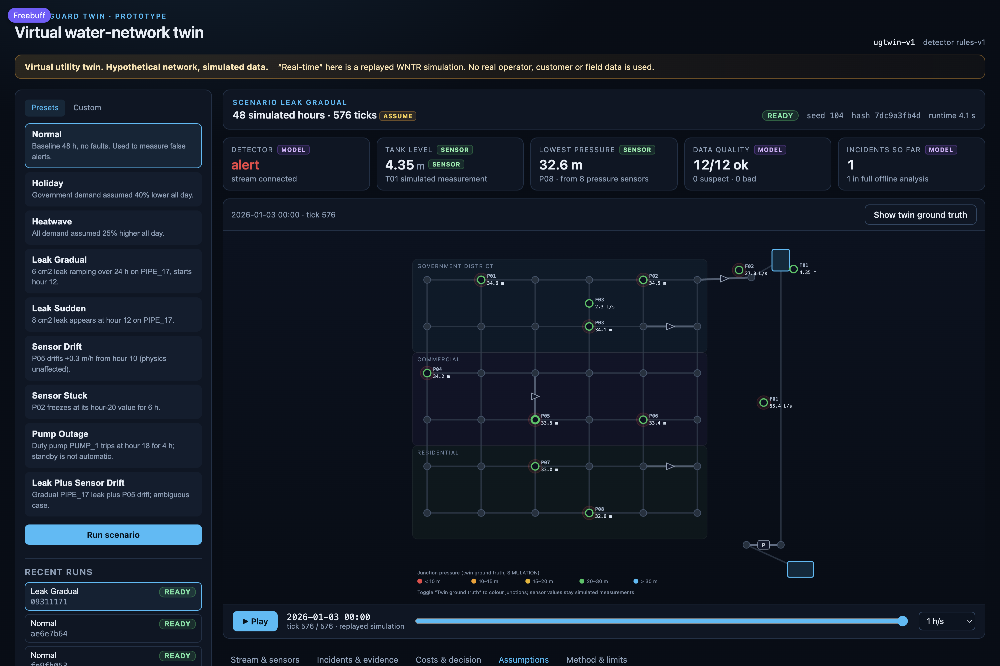

# UtilityGuard Twin

A simulation-driven virtual water-network twin: live replayed stream, data-quality layer, fault detection and diagnosis, cost/decision support, incident evidence trail, and a web dashboard.

> **Virtual utility twin. Hypothetical network, simulated data.**
> This is not a replica of any real city's infrastructure and uses no real operator data.
> “Real-time” means a **replayed WNTR simulation stream**, never live field data.
> Every number in the UI carries an evidence label (see below). Costs use placeholder currency units (`CU`) and editable assumptions.



---

## What it does

1. **Simulates** a hypothetical 36-junction, three-zone distribution grid with WNTR (pressure-dependent demand, duty/standby pumps, elevated tank, PRV, isolation valves).
2. **Adds a sensor layer** on top of physics: Gaussian noise plus injectable drift, stuck and dropout faults. Sensor measurements never feed back into the hydraulic simulation.
3. **Streams** the stored simulation over WebSocket with play/pause/scrub/speed controls. All physics and analysis run once per scenario; replay is deterministic.
4. **Checks data quality** (range, stuck, rate spikes, neighbour disagreement, tank mass balance) with a transparent scoring rule.
5. **Detects and diagnoses** changes against a fault-free baseline run using persistence + CUSUM residuals and rule precedence: pump → leak → sensor fault → demand change → unknown.
6. **Groups alerts into incidents** and produces an evidence record for every number (value, unit, label, formula, inputs, sources, explanation).
7. **Compares response options** (monitor / inspect / repair, or switch standby pump) using WNTR continuation runs, triangular Monte Carlo over editable price assumptions, constraints, sensitivity and break-even thresholds.
8. **Evaluates itself** on all presets and writes `docs/eval_report.md` and `data/eval_report.json`.

The network is deliberately synthetic. Geometry, demand curves, sensor placement and prices are stated assumptions. See [docs/architecture.md](docs/architecture.md).

## Quick start

Requirements: Python ≥ 3.11, Node ≥ 18, npm. Tested with Python 3.11 and Node 20.

```bash
make install   # creates .venv, installs backend (editable) and frontend deps
make start     # builds the SPA and serves UI + API on http://127.0.0.1:8000
```

Open <http://127.0.0.1:8000>. The first scenario (`normal`) starts automatically if the database is empty; it takes a few seconds to simulate.

Development with hot reload (two terminals):

```bash
make backend    # http://127.0.0.1:8000 (API + WebSocket)
make frontend   # http://127.0.0.1:5173 (Vite proxy to the API)
```

Docker alternative:

```bash
make up    # docker compose: backend on :8000 and nginx-served frontend on :5173
```

### Tests and evaluation

```bash
make test     # pytest: simulation determinism, sensor isolation, quality, detector, finance, evidence, API
make eval     # all presets + cost analysis; writes docs/eval_report.md
```

## Scenarios

Presets are fixed-seed and reproducible (`backend/app/scenarios/library.py`):

| Preset | Fault(s) |
| --- | --- |
| `normal` | none (48 h) |
| `holiday` | demand 40% lower all day |
| `heatwave` | demand 25% higher all day |
| `leak_gradual` | 6 cm² leak on PIPE_17 from hour 12, ramping over 24 h |
| `leak_sudden` | 8 cm² leak on PIPE_17 at hour 12 |
| `sensor_drift` | P05 drifts +0.3 m/h from hour 10 (physics unchanged) |
| `sensor_stuck` | P02 freezes at its hour-20 value for 6 h |
| `pump_outage` | PUMP_1 trips at hour 18 for 4 h; standby is not automatic |
| `leak_plus_sensor_drift` | gradual leak + P05 drift (ambiguous case) |

The **Custom** tab builds a scenario from the same contract: duration, pipe leak (start, area, gradual/sudden), pressure-sensor drift and a pump outage. The JSON schema is documented in [docs/scenario_schema.md](docs/scenario_schema.md).

To add a preset, add a `ScenarioConfig` to `PRESETS` with a distinct seed and a note; the API, UI and evaluation pick it up automatically.

## Evidence labels

| Label | Meaning |
| --- | --- |
| `SIMULATION` | WNTR output (the twin's ground truth) |
| `SENSOR_SIM` | simulated measurement (truth + noise + injected sensor fault) |
| `MODEL` | quality layer / detector / diagnosis / ranking output |
| `ASSUMPTION` | editable placeholder input (prices, demand curves, thresholds) |
| `CALCULATED` | arithmetic over other labelled values; formulas are shown |
| `INSUFFICIENT_EVIDENCE` | data cannot support a value; nothing is guessed |

The detector only ever sees `SENSOR_SIM` readings. Ground truth is available through `GET /api/runs/{id}/truth` for the optional map overlay and offline evaluation, and is never used as a detector input.

## What works (verified on this machine)

- Deterministic simulation: the same config + seed produce the identical SHA-256 output hash across runs.
- 48 h normal run in ~6 s; all presets simulate without solver errors.
- Detector: **6/6 declared fault scenarios detected**, **0 incidents on the three fault-free scenarios**, mean latency ≈ 1 simulated hour in the recorded evaluation.
- Sensor faults are isolated to the measurement layer: stuck/drifted readings change, physics does not.
- Quality layer flags stuck sensors as `bad` and drift against neighbours as `suspect`; fault-free runs keep suspect samples below 2% of readings.
- Cost arithmetic is unit tested line by line; Monte Carlo is seeded and reproducible; break-even thresholds are computed from fixed costs.
- WebSocket replay, pause/resume, speed change, seek and incident evidence all work through the dashboard.

## Known limitations (read this before trusting a number)

- **Leak localisation is weak.** On this looped 6×6 grid, a leak's head loss is spread across many paths and the tank's common-mode drawdown dominates the pressure signal. The evaluation records 0/2 top-1 and 0/2 top-3 hits. Candidate pipes are transparent hypotheses, not a confirmed location. Do not dispatch on them.
- Leak hydraulics use a constant area per chunk; gradual leaks are approximated by hourly chunks with tank carry-over.
- Isolation/repair is modelled as a reduced leak area, not as valve operations on the graph and not as a repaired topology.
- Detection thresholds were tuned on this synthetic network; there is no field validation, no ROC curve and no calibrated probability.
- Decision costs are model estimates conditional on placeholder assumptions. They are not tariffs, quotes or guarantees. No failure probability is invented; break-even thresholds are reported instead.
- The standby pump switch is modelled as opening PUMP_2 and closing PUMP_1 from the response time onward.
- Sensor placement is a fixed synthetic design, not an optimisation result.
- The evaluation set is small and authored by the same person as the detector. Treat its numbers as regression signals, not performance claims.

## What this prototype does not prove

It does not prove that the detector would find real leaks, that the localisation would help a crew, that the costs resemble a real utility's costs, or that the rules transfer to another network. It proves that the pipeline — deterministic WNTR simulation, separated sensor layer, quality gating, residual detection, evidence trail, WNTR-based cost comparison and replayable UI — can be built end to end with honest labels.

## Repository layout

```
backend/app/
  network/      hypothetical WNTR grid + NetworkProvider interface
  scenarios/    schema, presets, deterministic runner, sensor layer
  quality/      data-quality checks
  detect/       baseline expectation, detector, rules/diagnosis
  alerts/       incident grouping
  finance/      assumptions + cost lines + Monte Carlo
  impact/       WNTR continuation runs for response options
  decision/     ranking, constraints, sensitivity, break-even
  evidence/     per-number evidence records
  eval/         evaluation suite and report generator
  store/        SQLite run/incident/decision store
  main.py       FastAPI REST + WebSocket + static SPA
frontend/src/   React + Vite dashboard (SVG map, playback, panels)
docs/           architecture, schema, API notes, evaluation report
```

## API

| Endpoint | Purpose |
| --- | --- |
| `GET /api/health` | version + permanent disclaimer |
| `GET /api/network` | nodes, links, sensors, zones, assumptions |
| `GET /api/scenarios` | presets and notes |
| `POST /api/runs` | start a run (`scenario_id` or full `config`, optional `?wait=true`) |
| `GET /api/runs/{id}` | status, seed, hash, runtime |
| `GET /api/runs/{id}/truth` | twin ground truth (clearly labelled) |
| `GET /api/runs/{id}/readings` | simulated sensor stream + quality |
| `GET /api/runs/{id}/alerts` | incidents |
| `GET /api/incidents/{id}/evidence` | evidence records |
| `POST /api/incidents/{id}/analyze` | cost/decision analysis |
| `GET/PUT /api/assumptions` | editable assumption set |
| `WS /ws/runs/{id}?speed=` | replay frames + `pause`/`resume`/`speed`/`jump` controls |

## License / use

Prototype for demonstration and research. Not for operational use. No real utility data is included or implied.
